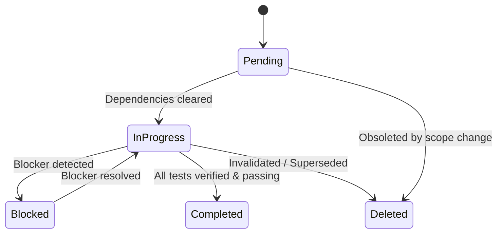

# Anthropic Claude Opus 5.5 & Fable 5.1 Architecture Playbook

> **Scope:** Reference playbook detailing Anthropic's state-of-the-art agent execution architecture, autonomous loop pacing formulas, task DAG dependencies, and tool interaction standards extracted and adapted for Google Antigravity.

---

## 1. Autonomous Loop Pacing & Prompt Cache Preservation

Modern LLM APIs employ prompt caching with 5-minute to 1-hour Time-To-Live (TTL) windows. Careless autonomous agent loops that poll every few seconds burn millions of tokens on redundant input processing.

### Mathematical Delay Calibration Matrix

| Target State Type | Typical Change Velocity | Recommended `delaySeconds` | Strategy |
| :--- | :--- | :--- | :--- |
| **Local File Builds / Lint** | 5s – 30s | `60s – 120s` | Allow build tools to finish; avoid hot-looping. |
| **Local Unit Test Suites** | 10s – 60s | `60s – 90s` | Single check after test runner exits. |
| **Remote CI/CD Pipelines** | 5 min – 15 min | `480s` (8 min) | Schedule one targeted check; never run 8–10 micro-polls. |
| **Container Deploys / K8s** | 3 min – 10 min | `300s – 600s` | Align with deployment rolling update window. |
| **Idle Heartbeat / Queue Poll** | Indefinite | `1200s – 1800s` (20–30 min) | Keeps session alive and cached without token bleed. |

### The No-Op Streak Collapsing Pattern

```text
[Loop Tick 1] Checking CI status... Status: PENDING (noop: true)
[Loop Tick 2] Checking CI status... Status: PENDING (noop: true)
[Loop Tick 3] Checking CI status... Status: PENDING (noop: true)
=> Terminal View: "Checking CI status... (3 quiet hold ticks collapsed, 12m elapsed)"
[Loop Tick 4] Checking CI status... Status: SUCCESS (noop: false) -> Proceeding to deployment verification!
```

---

## 2. Task DAG Dependency Engine (`TaskCreate` / `TaskUpdate`)

Large-scale agentic engineering tasks must never be executed as an unstructured mental list. They must be tracked as a Directed Acyclic Graph (DAG) with explicit blocker resolution.

### Task State Machine



### The 4 Ironclad Completion Invariants

An agent must **never** mark a task as `completed` if:

1. **Failing Tests:** Any assertion in the unit or integration suite fails or is commented out.
2. **Partial Implementation:** A function returns dummy stubs, `TODO`, or placeholder values.
3. **Unresolved Diagnostics:** Linter, TypeScript compiler, or runtime console errors remain.
4. **Missing Dependencies:** A referenced module, schema, or configuration file does not exist on disk.

---

## 3. Communication & Tool Hygiene (`reply_after_tool_calls`)

To maintain senior engineering discipline and prevent terminal clutter:

1. **No Pre-Tool Echoes:** Never write *"I will now run the tests"* before the tool, and then follow up with *"As I just ran the tests..."* after the tool. State only what changed and what the evidence proves.
2. **Evidence-First Answers:** Replace *"Done."* with *"All 14 unit tests passed in 1.42s; zero regressions detected across auth and data layers."*
3. **Compact Prose:** Use paragraphs for logical reasoning; reserve bullet points for comparing multifaceted trade-offs or action items.
