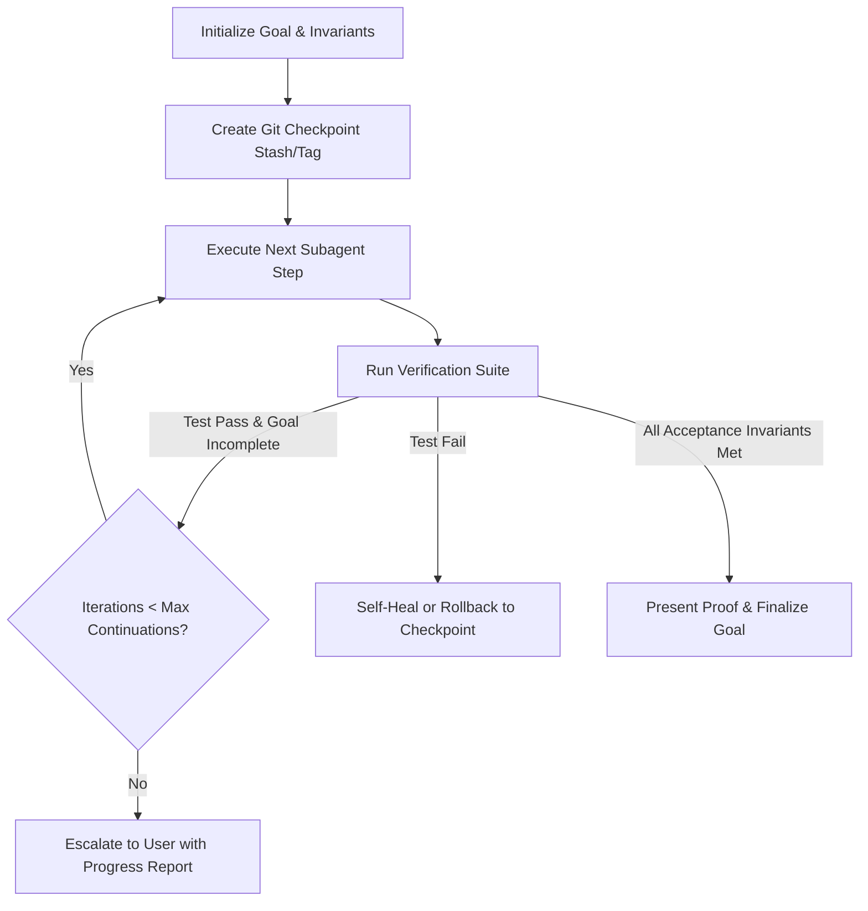

# Autonomous Goal Execution Workflow (DeerFlow Pattern)

A long-horizon, multi-turn autonomous goal loop inspired by ByteDance's DeerFlow harness architecture. It executes complex, multi-step engineering objectives with persistent state checkpoints, auto-evaluating goal conditions across multiple iterations without stopping prematurely.

---

## Core Invariant: The Goal Continuation Contract



- **Objective Bound:** The user's prompt is bound as an unambiguous Goal with measurable criteria.
- **Max Continuations:** Allows up to 8 autonomous iterations (`max_continuations = 8`) to achieve the goal. The agent does NOT halt and say "let me know if you want me to continue" while verified work remains.
- **Atomic Checkpoints:** Every iteration begins with a clean workspace checkpoint. If an iteration introduces an unfixable syntax or regression error, the agent reverts atomically to the last known green checkpoint.

---

## Execution Routine

### Phase 1: Goal Definition & Checkpoint Anchor

- **Persona:** `architect` / `planner`
- **Active Skills:** `domain-modeling`, `to-spec`, `writing-plans`
- **Actions:**
  1. Define the target end-state: exact files to touch, tests to pass, and behavior to exhibit.
  2. Create an initial Git checkpoint:

     ```powershell
     git stash create "pre-goal-checkpoint"
     ```

  3. Initialize task DAG in memory with distinct sub-goals.

### Phase 2: Iteration Execution Loop

- **Persona:** Domain specialist (`fastapi-reviewer`, `react-reviewer`, `network-architect`, etc.)
- **Active Skills:** `test-driven-development`, `codebase-design`, `surgical-editing`
- **Actions:**
  1. Pick the next uncompleted dependency node from the task DAG.
  2. Execute surgical changes using `replace_file_content` or `multi_replace_file_content`.
  3. Avoid drive-by edits; preserve existing naming, comments, and style conventions.

### Phase 3: Step-Level Verification Gate

- **Persona:** `silent-failure-hunter` / `tdd-guide`
- **Active Skills:** `verification-loop`, `error-handling`
- **Actions:**
  1. Run the target test or build command (`npm test`, `pytest`, `cargo test`, `vite build`).
  2. **On Failure:** Diagnose root cause immediately. Attempt 1 surgical self-healing fix. If failure persists, rollback the iteration:

     ```powershell
     git checkout -- .
     ```

  3. **On Success:** Commit step progress to the session ledger and advance to the next task node.

### Phase 4: Goal Invariant Evaluation

- **Persona:** `swe-code-reviewer` / `code-simplifier`
- **Active Skills:** `verification-before-completion`, `finishing-a-development-branch`
- **Actions:**
  1. Check all goal invariants:
     - Are 100% of required files updated?
     - Do all unit and integration tests pass with zero regressions?
     - Is the build clean without type errors or lint warnings?
  2. If invariants are met, display complete terminal verification proof and present the final summary to the user.
