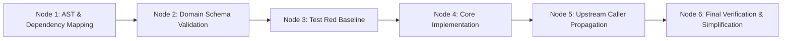

# Resilient DAG Refactoring Workflow (Dify Pattern)

A structured, dependency-aware refactoring pipeline inspired by LangGenius Dify's execution DAGs and node error traps. It safely coordinates complex, multi-file code modifications with explicit state handoffs and failure boundaries.

---

## Architectural DAG Nodes

### Node Invariants

1. **Typed State Handoff:** Each node outputs an explicit manifest of modified symbols, files, and exports before the downstream node begins.
2. **Error Trapping & Bounded Retries:** A node can retry a failed operation up to 2 times with a modified hypothesis. If the failure persists, the entire workflow pauses and isolates the fault before breaking downstream code.
3. **Atomic File Isolation:** Edits are contained within the designated node scope.

---

## Workflow Steps

### Node 1: Dependency & Call-Site Graph Mapping

- **Persona:** `architect` / `code-explorer`
- **Active Skills:** `gsd-graphify`, `wayfinder`, `domain-modeling`
- **Execution:**
  1. Map all incoming and outgoing dependencies of the target symbols.
  2. Identify all callers, importers, and interface contracts.
  3. Output: `refactor_target_manifest.json` in memory.

### Node 2: Domain Schema & Interface Update

- **Persona:** `swe-code-reviewer`
- **Active Skills:** `domain-modeling`, `to-spec`
- **Execution:**
  1. Update type definitions, interfaces, Pydantic schemas, or TypeScript types first.
  2. Enforce strict immutability, discriminated unions, and branded types where appropriate.
  3. Verify typecheck fails *only* where expected call sites have not yet been updated.

### Node 3: Test Baseline Enforcement (TDD Red)

- **Persona:** `tdd-guide`
- **Active Skills:** `test-driven-development`, `verification-loop`
- **Execution:**
  1. Write unit tests capturing the new refactored contract and behaviors.
  2. Confirm test fails for the right reasons (Red phase).

### Node 4: Implementation Node

- **Persona:** Specialist (`fastapi-reviewer`, `react-reviewer`, etc.)
- **Active Skills:** `code-simplifier`, `fastapi-patterns`, `react-patterns`
- **Execution:**
  1. Apply surgical modifications to internal logic.
  2. Replace deprecated patterns with clean modern syntax.
  3. Preserve all non-modified function signatures and comments.

### Node 5: Caller Propagation & Migration

- **Persona:** `code-simplifier`
- **Active Skills:** `improve-codebase-architecture`, `clean-diffs`
- **Execution:**
  1. Systematically update all call sites identified in Node 1.
  2. Remove deprecated adapter layers if all call sites have been migrated.

### Node 6: Verification & Final Quality Gate

- **Persona:** `swe-code-reviewer` / `silent-failure-hunter`
- **Active Skills:** `verification-before-completion`, `code-simplification`
- **Execution:**
  1. Execute full project test suite and typechecks (`npm test`, `pytest`, `tsc`).
  2. Audit with `code-simplification`: Apply Chesterton's Fence and Rule of 500 to ensure zero added complexity.
  3. Print terminal evidence proving 100% clean compilation.
