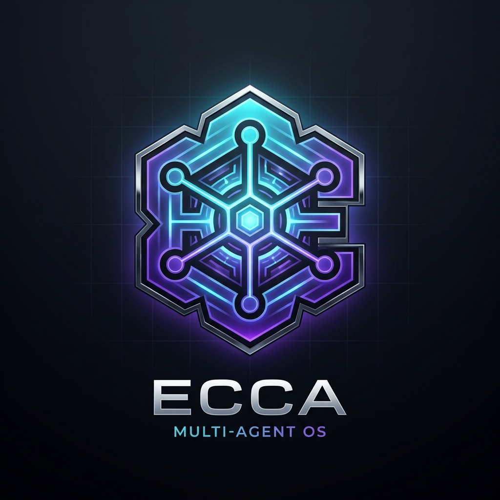
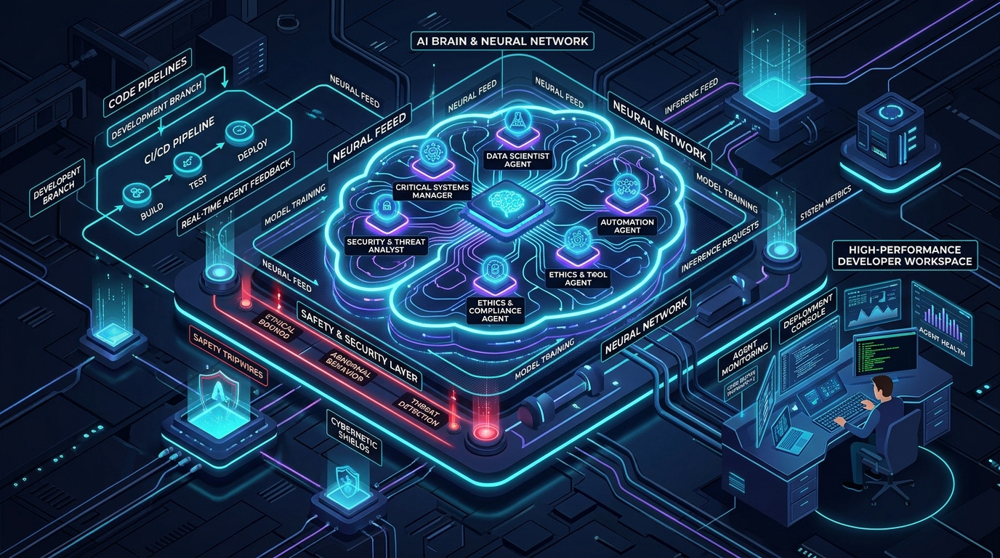
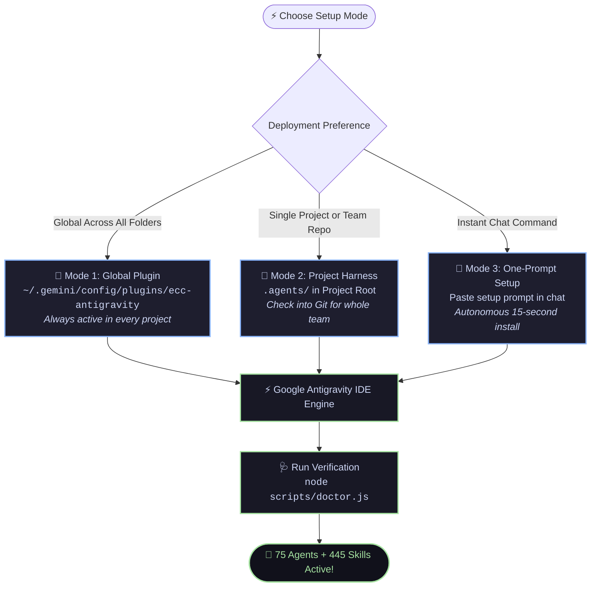
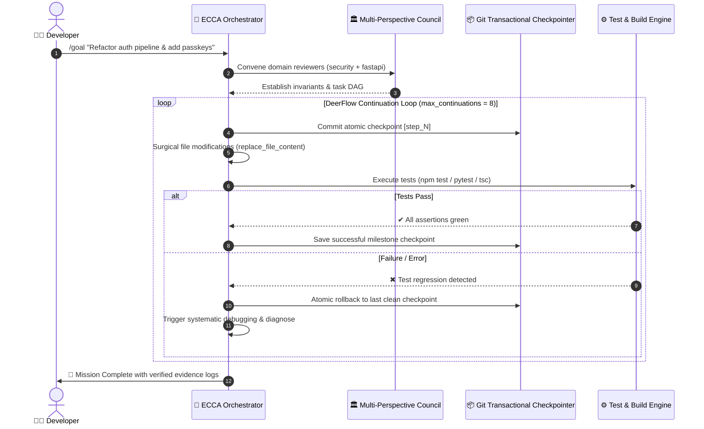
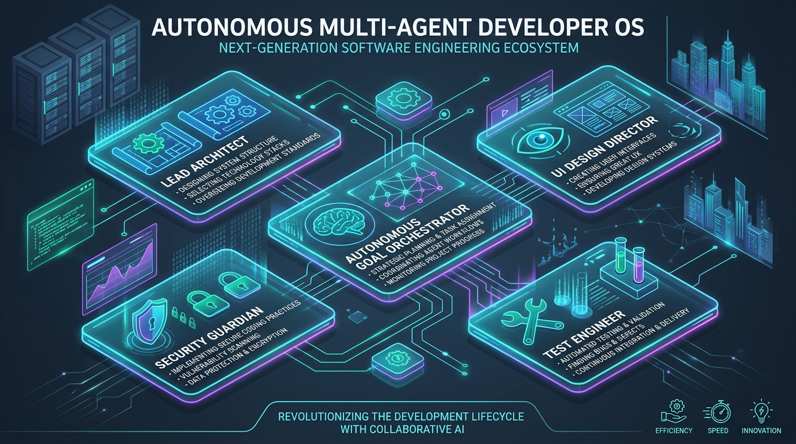
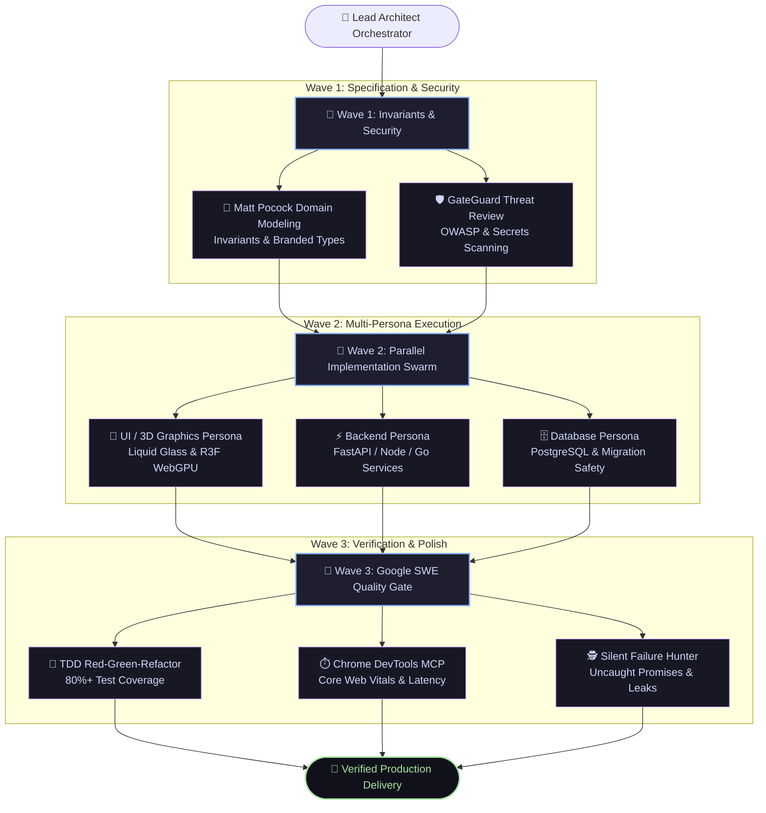

# ⚡ ECCA v2: Enterprise Cognitive Coding Architecture 🚀



> **The Autonomous Multi-Agent Brain for 10x Software Engineering on Google Antigravity IDE & Gemini CLI.**  
> Unifying 75 Specialized AI Personas, Stanford STORM Research, ByteDance DeerFlow Long-Horizon Loops, Daytona & GateGuard Safety Shield, Matt Pocock Domain Modeling, Addy Osmani Google SWE Quality Gates, and 445 Production Skills into a Self-Directing Engineering Harness.



[](https://github.com/Omkarop0808/ECCAV2-antigravity)
[](https://github.com/Omkarop0808/ECCAV2-antigravity#-multi-agent-ecosystem-hub)
[](https://github.com/Omkarop0808/ECCAV2-antigravity#-curated-skills-catalog-445-skills)
[](https://github.com/Omkarop0808/ECCAV2-antigravity)
[](https://github.com/Omkarop0808/ECCAV2-antigravity)
[](https://github.com/Omkarop0808/ECCAV2-antigravity#-instant-slash-commands)
[](LICENSE)
[](https://github.com/Omkarop0808/ECCAV2-antigravity)

**[⚡ Quick Install](#-how-to-install-in-any-project)** • **[🧠 Cognitive Architecture](#-the-ecca-cognitive-engine-key-mechanism--architecture)** • **[🤖 75 Agents Hub](#-multi-agent-ecosystem-hub)** • **[📦 445 Skills Catalog](#-curated-skills-catalog-445-skills)** • **[💬 Instant Slash Commands](#-instant-slash-commands)**

---

## 📖 Overview

**ECCA v2** transforms Google Antigravity into a coordinated multi-agent engineering powerhouse:

- 🤖 **75 Specialized Personas:** Domain experts (`security-reviewer`, `architect`, `fastapi-reviewer`, `react-reviewer`, `silent-failure-hunter`, `tdd-guide`).
- 🔬 **Stanford STORM Research:** 5-phase simulated interrogation and citation-backed RFC outlines before touching code (`storm-research`).
- 🔁 **ByteDance DeerFlow Autonomous Loops:** Long-horizon execution loops (`autonomous-goal`) with `max_continuations = 8` and transactional Git checkpoints.
- 🛡️ **Daytona & GateGuard Safety Shield:** First-touch tripwires on `.env`, secrets, auth, and DB migrations, with workspace containment.
- 🏆 **Google SWE Production Gates:** Addy Osmani anti-rationalization invariants, TDD Red-Green-Refactor, Rule of 500, and Chesterton's Fence simplification.
- 🎨 **Impeccable Design & 3D WebGPU:** Apple-grade liquid glass, optical alignment, and 13 WebGPU / Three.js Shading Language (TSL) skills.

---

## ⚡ How to Install in ANY Project



### 🌟 Mode 1: Global Plugin (Recommended for All Projects)

Installs ECC globally in `~/.gemini/config/plugins/ecc-antigravity`. All 75 agents and 445 skills become automatically active across **every folder and project you open**:

```bash
# Clone directly as a global plugin (macOS / Linux / Windows Git Bash):
git clone https://github.com/Omkarop0808/ECCAV2-antigravity.git ~/.gemini/config/plugins/ecc-antigravity
```

Or run the installer if you already cloned the repository:

```powershell
# PowerShell (Windows):
& ".\install.ps1" -Plugin
```

```bash
# Bash (macOS / Linux / WSL):
./install.sh --plugin
```

---

### 👥 Mode 2: Project Harness (For Teams, Repos & Hackathons)

Installs `.agents/` directly into your project root so anyone who clones your repo inherits the full harness:

```powershell
& ".\install.ps1" -TargetPath "C:\path\to\YourProject"
```

```bash
./install.sh /path/to/YourProject
```

---

### 💬 Mode 3: One-Prompt Instant Setup (In Antigravity Chat)

Paste this into the Antigravity chat box inside **any project**:

> **"Set up ECC Antigravity in this workspace: Clone `https://github.com/Omkarop0808/ECCAV2-antigravity.git` into a temporary folder, copy `.agents/`, `.gemini/`, `AGENTS.md`, and `GEMINI.md` to this workspace root, clean up the temporary folder, and run `node scripts/doctor.js` to verify that all 75 specialized agents and 445 production skills are active."**

---

### 🩺 Verify Installation

```bash
node scripts/doctor.js
```

Runs 17 comprehensive health checks (agents frontmatter, 445 indexed skills, safety rules, and slash commands).

---

## 🧠 The ECCA Cognitive Engine: Key Mechanism & Architecture

### 1. Multi-Agent Reasoning & Execution Flowchart

```mermaid
flowchart TD
    User([👨‍💻 Developer Prompt]) --> HUD[⚡ Developer Transparency HUD]
    HUD --> Intent{Intent Classification\nIntents A - J}
    
    subgraph CognitiveBrain ["🧠 ECCA Cognitive Brain (75 Domain Personas)"]
        Intent -->|Architecture / Tech Eval| STORM[Stanford STORM Council\n5-Phase Perspective Interrogation]
        Intent -->|Complex Feature / Module| Planner[Planner + Architect Personas\nSpec Extraction & Domain Models]
        Intent -->|UI / Aesthetics| Impeccable[Impeccable Design Director\nLiquid Glass & Optical Alignment]
        Intent -->|Bug / Flaky Test| Hunter[Silent Failure Hunter\nTDD Red-Green-Refactor]
        Intent -->|Overnight / Long-Horizon| DeerFlow[ByteDance DeerFlow\nAutonomous Continuation Loop]
    end

    subgraph SkillsRegistry ["📦 Dynamic Skills Resolution Engine"]
        STORM & Planner & Impeccable & Hunter & DeerFlow --> DynamicIndex[Dynamic SKILLS_INDEX.md\nSub-25ms Zero-Bloat Retrieval\n445 Curated Skills]
    end

    subgraph SafetyEnvelope ["🛡️ Daytona & GateGuard Safety Shield"]
        DynamicIndex --> Tripwires{Tripwire Check\n.env | DB Migrations | Auth}
        Tripwires -->|Safe Path| Tools[Surgical Tool Execution\nview_file · replace_file · run_command]
        Tripwires -->|Sensitive Target| Sandbox[Daytona Workspace Isolation\nDry-Run Verification]
    end

    subgraph VerificationGate ["🏆 Google SWE Verification Gate"]
        Tools & Sandbox --> Tests[Run Tests / Lints / Builds\nConcrete Terminal Evidence]
        Tests --> Done([🚀 Verified Production Code Delivered])
    end

    classDef brain fill:#1e1e2e,stroke:#89b4fa,stroke-width:2px,color:#cdd6f4;
    classDef skills fill:#181825,stroke:#f38ba8,stroke-width:2px,color:#cdd6f4;
    classDef safety fill:#181825,stroke:#a6e3a1,stroke-width:2px,color:#cdd6f4;
    classDef verify fill:#11111b,stroke:#fab387,stroke-width:2px,color:#cdd6f4;
    class CognitiveBrain brain;
    class SkillsRegistry skills;
    class SafetyEnvelope safety;
    class VerificationGate verify;
```

### 2. Autonomous Long-Horizon Goal & Error Recovery Loop



---

## 🤖 Multi-Agent Ecosystem Hub



ECCA v2 orchestrates **75 specialized domain personas** mapped into 5 elite engineering pillars:

| Pillar | Focus | Key Personas & Skills |
| :--- | :--- | :--- |
| 🏛️ **Lead Architecture** | Topology, invariants, distributed flows | `architect`, `planner`, `domain-modeling`, `to-spec` |
| 🎨 **UI / UX Direction** | Apple liquid glass, typography, motion | `impeccable`, `a11y-architect`, `liquid-glass-design` |
| 🔁 **Goal Orchestration**| Autonomous 8-step loops & error DAGs | `autonomous-goal`, `resilient-dag-refactor`, `gsd-manager` |
| 🛡️ **Security Guardian** | Zero-leak secrets, OWASP, tripwires | `security-reviewer`, `gateguard`, `canary-watch` |
| 🧪 **SWE Quality Gate** | TDD Red-Green-Refactor, telemetry | `test-engineer`, `silent-failure-hunter`, `tdd-guide` |

### Multi-Agent Swarm Wave Parallelization



---

## 📦 Curated Skills Catalog (445 Skills)

To prevent context window bloat, ECCA v2 uses a **Dynamic Sub-25ms Skills Resolver** governed by [`.agents/rules/automatic-routing-policy.md`](file:///.agents/rules/automatic-routing-policy.md). Skills are loaded via `view_file` only when triggered:

| Domain Pillar | Skills Count | Key Highlights |
| :--- | :--- | :--- |
| 🎨 **UI/UX & Design Craft** | 11 skills | `impeccable`, `liquid-glass-design`, `ui-ux-pro-max`, `make-interfaces-feel-better` |
| 🎮 **3D WebGPU & Shaders** | 13 skills | `threejs-tsl-webgpu`, `r3f-fundamentals`, `r3f-shaders`, `r3f-physics`, `r3f-materials` |
| 🧠 **GSD & Graphify Engine**| 64 skills | `gsd-graphify` (saves 70%+ token context), `gsd-plan-phase`, `gsd-audit-fix` |
| 🔬 **Research & Autonomous**| 5 skills | `storm-research` (Stanford 5-phase), `autonomous-goal` (DeerFlow loop), `resilient-dag-refactor` |
| 🛡️ **Cybersecurity & Safety**| 8 skills | `canary-watch`, `security-review`, `agent-security-hardening`, `gateguard` |
| 📐 **Domain Modeling** | 11 skills | `domain-modeling` (Matt Pocock invariants), `to-spec`, `grill-with-docs`, `wizard` |
| 🌐 **Networking & Infra** | 8 skills | `network-interface-health`, `network-bgp-diagnostics`, `netmiko-ssh-automation` |
| ⚡ **Languages & Frameworks**| 325 skills | FastAPI, React, Next.js, Node, Python, Go, Rust, Java, Swift, Kotlin, Docker, SQL |

> 👉 **Search the full catalog of all 445 skills with triggers and paths in [`.agents/SKILLS_INDEX.md`](file:///.agents/SKILLS_INDEX.md).**

---

## 🚀 Instant Slash Commands

| Command | What It Triggers | When to Use |
| :--- | :--- | :--- |
| **`/goal`** | ByteDance DeerFlow Autonomous Loop (`max_continuations = 8`) | Long-horizon overnight tasks, complex multi-file features. |
| **`/storm`** | Stanford STORM Multi-Perspective Research Protocol | Technical evaluation, architecture RFCs, comparing libraries. |
| **`/domain-model`** | Matt Pocock Domain Modeling & Branded Types | Clarifying core business logic, invariants, discriminated unions. |
| **`/build`** | Phased Feature Architecture & Implementation | Building significant new screens, modules, or services. |
| **`/spec`** | Spec-Driven Development Pipeline | Clarifying requirements, edge cases, and acceptance criteria. |
| **`/test`** | Google SWE Test-Driven Development (Red-Green-Refactor) | Adding comprehensive unit, integration, and E2E test suites. |
| **`/ship`** | Full Verification, Lint, Security & PR Finishing | Running full pre-merge quality gates before pushing code. |

---

## 💬 Natural Prompting Showcase

No memorization needed. State what you want to build and the **Intent Classifier** automatically summons the right personas and tools:

| What You Say | Autonomous Multi-Agent Action |
| :--- | :--- |
| *"Build a FastAPI route for stripe webhook verification with Redis idempotency."* | Adopts `fastapi-reviewer` + `security-reviewer`, loads `fastapi-patterns`, `redis-patterns`, and `security-review`. |
| *"Design a liquid glass navbar with specular rims, blur, and WCAG accessibility."* | Adopts `impeccable` + `a11y-architect`, loads `liquid-glass-design` and `make-interfaces-feel-better`. |
| *"Create an interactive R3F particle canvas with custom WebGPU TSL compute shaders."* | Adopts `react-reviewer` + `architect`, loads `threejs-tsl-webgpu`, `r3f-fundamentals`, and `r3f-shaders`. |
| *"Our websocket connection drops silently under load and leaks memory."* | Adopts `silent-failure-hunter` + `performance-optimizer`, loads `systematic-debugging`. |
| *"Evaluate migrating our messaging pipeline to Go vs Rust. Produce an RFC."* | Adopts `architect`, executes 5-phase `storm-research` with simulated stakeholder interrogation. |

---

## ⚡ The Developer Transparency HUD

For every non-trivial task, ECCA displays a real-time HUD at the start of its response:

```markdown
> ⚡ **[Persona: `architect` + `security-reviewer` | Skills: `domain-modeling`, `storm-research` | Mode: Intent C]**
```

---

## 📄 License

MIT License. Derived from and compatible with Everything Claude Code (ECC). Distributed for use with Google Antigravity IDE and Gemini CLI.
